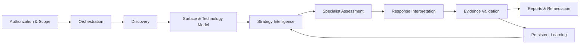

# Battle Offensive AI — Public System Architecture

**Scope:** Research architecture only. No private code, engagement configuration, active credentials, or exploit instructions are published in this repository.

[← Main README](README.md) · [AI Intelligence Level](AI_INTELLIGENCE_LEVEL.md)

---

## Architecture at a Glance

Battle Offensive AI is an **autonomous offensive cybersecurity research framework** that coordinates observation, context modeling, strategy selection, controlled testing, response interpretation, evidence evaluation, reporting, and learning.

Its documented orchestration distinguishes:
1. **An operator's authorized scope** and execution constraints.
2. **Discovery** of applications, technology, endpoints, and relevant infrastructure signals.
3. **Intelligent planning** using the observed environment and historical context.
4. **Specialist assessment engines** operating on the approved surface.
5. **Interpretation and validation** of response evidence.
6. **Reporting and feedback** that improve subsequent decisions.



---

## 1. Control and Orchestration

The control layer is responsible for composing the assessment lifecycle, applying selected module groups, tracking completion, and persisting state.

Its documented responsibilities include:
- Stage and module selection
- Authentication/session context management
- Scoped endpoint management
- Resumability and checkpointing
- Concurrency and request-budget constraints
- Logging of relevant decisions and outcomes
- Coordination between intelligence and specialist assessment modules

A resumable process is important for lengthy assessments. However, a persisted checkpoint is only trustworthy if the approved scope and execution permissions are revalidated before resumption.

---

## 2. Discovery and Attack-Surface Context

The discovery layer creates a structured picture of the **authorized** environment.

| Subsystem | Public description |
|---|---|
| Application discovery | Crawl and endpoint identification |
| Parameter analysis | Find relevant request parameters and form inputs |
| API context | Identify applicable web service interface types |
| Technology fingerprinting | Infer software families, frameworks, and platform context |
| Infrastructure inspection | Review relevant TLS, DNS, header, and service configuration |
| Session context | Observe the authorized authentication state and available functions |
| Intelligence enrichment | Associate applicable vulnerability advisories and platform knowledge |

The output is not simply a URL list. It is contextual data used to decide which security questions apply to each surface.

---

## 3. Strategy and Planning

The strategy layer prioritizes **eligible assessment categories** using multiple evidence sources.

### Context sources

- Discovered application and infrastructure technology
- Applicable security testing category preconditions
- Endpoint and parameter characteristics
- Previous locally relevant testing outcomes
- Historical, appropriately separated intelligence
- Model-based response insights
- Optional language-model reasoning

### Research mechanisms

**Heuristic preclusion** removes obviously inapplicable candidate categories before expensive reasoning is used.

**Stack-aware adaptive statistics** consider whether a prior technique performed well in a comparable environment.

**Thompson Sampling** uses probabilistic exploration and exploitation rather than a permanently fixed ranking.

**Markov transition intelligence** supplies potential follow-on hypotheses conditioned on prior observations.

**AI reasoning** contributes contextual interpretation but remains dependent on validated observations and the operator's scope.

---

## 4. Specialist Assessment Engines

The documented project contains a modular set of testing domains, including:

- Web application input and rendering security
- API object-level and function-level authorization
- Authentication, token, and session behavior
- Framework and protocol configuration
- Cryptographic choices and randomness properties
- Storage and information disclosure
- Workflow integrity, business logic, and tenant boundaries
- Infrastructure and service exposure

The source documentation describes **97 selectable pipeline identifiers** spanning discovery, core assessment, supplementary categories, and reporting. The identifier count is a workflow size metric, not a validated detection-rate metric.

The core safety requirement is that the set of enabled tests remains limited to the **specifically authorized scope and acceptable impact**.

---

## 5. Response Intelligence

The analysis layer helps turn unstructured response data into observations usable by validation and learning.

### Semantic response classification

| Class | Interpretation |
|---|---|
| Confirmed hit | Evidence meets a defined confirmation condition |
| Partial success | Suggestive but incomplete observation |
| Error leak | Diagnostic information became visible |
| State change | Application state or behavior changed |
| Blocked | Security or application control rejected the probe |
| Clean miss | No relevant observed signal |

### Supporting signal analysis

- Baseline and controlled comparison
- Response normalization
- Behavioral anomaly analysis
- Clustering related observations
- ONNX-based anomaly and class scoring
- Distinction between blocked requests and negative test results

**The presence of an unusual response is insufficient to establish exploitation.** Human review and independent corroboration may still be required.

---

## 6. Evidence Validation and Quality Gates

The documented validation architecture includes:

- Attack-category-specific confirmation criteria
- Confidence scoring and severity context
- Proof and corroboration considerations
- Filtering of unsupported or ambiguous results
- Normalized finding types for downstream reporting
- Evidence and request/response trace preservation

The internal audit identified, then recorded fixes for, several correctness risks: incorrect ML training labels, missing evidence propagation, and ambiguity between partial signals and confirmed outcomes.

The significance of these fixes is architectural: **a self-learning system can become worse if incorrect findings are admitted as high-confidence training examples**.

---

## 7. Machine Learning and Persistent Feedback

The documented inference system uses ONNX components for feature normalization, anomaly detection, threat classification, and a complementary reputation signal.

The audit discusses a **28-feature base response vector**, expanded to **32 features** by adding semantic observation values.

The learning program includes:

| Component | Role |
|---|---|
| Confirmed finding store | Qualified reusable observations |
| Adaptive performance statistics | Empirical ranking feedback |
| Generated-candidate store | New candidates, not automatically validated |
| ML outcome records | Structured data for retraining |
| Target model snapshots | Specialized historical model context |
| Transition history | Relationships between observed categories |
| Confidence calibration | Feedback based on reviewed correctness |
| Quality gate and rollback | Prevent uncontrolled model degradation |

A later Phase I development record describes use of stable per-probe identifiers to join observed responses and learning records, and a post-assessment retraining stage.

### Learning loop

```text
OBSERVATION
    |
    v
INTERPRETATION
    |
    v
QUALIFIED OUTCOME
    |
    v
PERSISTED RECORD
    |
    v
ADAPTIVE STATS / MODEL UPDATE
    |
    v
FUTURE CONTEXTUAL DECISION
```

---

## 8. Reporting and Engineering Observability

The documented platform supports technical findings and evidence records, assessment reports, remediation guidance, and execution traces.

Structured outcomes are more useful when an engineer can distinguish:

1. A request was issued.
2. An unusual response was observed.
3. A possible security finding was inferred.
4. The required validation was performed.
5. The finding was accepted, rejected, or left inconclusive.
6. The final outcome was admitted into appropriate learning records.

A record of these distinctions improves troubleshooting and protects future training quality.

---

## 9. Research Governance

The system is intended for private, non-commercial cybersecurity research under operator-defined authorization.

**Operational design requirements:**

- Authorize targets and assessment windows before live testing.
- Keep customer data and engagement-specific results confidential.
- Exclude disruptive categories without explicit approval.
- Separate public descriptions from private code and exploit artifacts.
- Ensure resumed tasks continue to respect the original scope.
- Retain auditable context for decisions and validated outcomes.
- Prevent sensitive training data from crossing client boundaries.

The original internal documents contain operational material that is **deliberately excluded** from this public architecture report.

---

## 10. Documentary Status

The May 2026 audit records the implementation of fourteen Phase A–E learning upgrades, twenty-one Phase F/G/H improvements, and 52/52 functional tests passing. The later Phase I checklist records 108/108 development tasks checked complete.

Those milestones are **internally documented**, not independently retested as part of this public release.

For the complete research-level explanation, see [AI_INTELLIGENCE_LEVEL.md](AI_INTELLIGENCE_LEVEL.md).

---

**Elite Cybersecurity Specialist — Battle Offensive AI Research**
