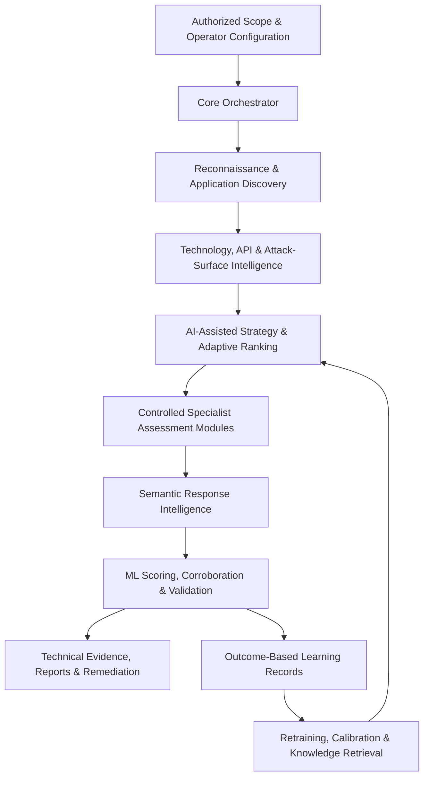

# BATTLE OFFENSIVE AI

### Autonomous Offensive Cybersecurity Intelligence & Self-Learning Penetration Testing

**Developed by Yuhisern Navaratnam — Cybersecurity Engineer, Elite Cybersecurity Specialist, Malaysia.**

> [!IMPORTANT]
> **Private, non-commercial research.** Battle Offensive AI is an existing autonomous offensive cybersecurity research system intended for testing within explicitly authorized environments. This public repository presents the research architecture and documented engineering progress; it does **not** publish the private scanner source code, customer assessment files, credentials, or working exploitation artifacts.

**DISCOVER. ANALYZE. TEST. VALIDATE. LEARN.**

[Company Profile](https://github.com/elite-cybersecurity-specialist/company-profile) · [LinkedIn Company Page](https://www.linkedin.com/company/elite-cybersecurity-specialist/) · [Official ECS Blog](https://elite-cybersecurity-specialist.blogspot.com)

---

## Executive Overview

**Battle Offensive AI** is a modular, autonomous penetration-testing research framework that combines environment discovery, application and API analysis, AI-assisted testing strategy, controlled specialist security assessments, machine-learning response intelligence, vulnerability confirmation, technical reporting, and persistent feedback.

Conventional assessment tools largely execute predefined routines and return findings for interpretation. Battle Offensive AI's research goal is a more integrated intelligence cycle: **observe an environment, reason about applicable security questions, run authorized tests, evaluate evidence, learn from outcomes, and improve subsequent decisions**.

The project is already an extensively developed codebase. Its engineering documentation describes a structured assessment pipeline, specialist modules, persistent training datasets, ONNX models, probabilistic attack selection, and successive rounds of implementation and test verification.

### Key research characteristics

| Research capability | Documented approach |
|---|---|
| Autonomous reconnaissance | Discovers applications, infrastructure signals, endpoints, APIs, and technology context |
| Intelligent strategy | Uses technology fingerprints, heuristics, historical outcomes, and optional language-model reasoning |
| Modular assessment | Coordinates specialist web, API, identity, workflow, and infrastructure testing categories |
| Semantic response analysis | Interprets results as confirmed, partial, blocked, error, state-change, or clean observations |
| ML-assisted analysis | ONNX-based feature processing, anomaly scoring, and classification |
| Validation | Baselines, corroboration checks, confidence scoring, and vulnerability-specific confirmation |
| Self-learning | Historical testing outcomes, stack-specific adaptive statistics, retraining, and reusable knowledge |
| Evidence and reporting | Technical findings, audit traces, remediation context, and report generation |

> [!NOTE]
> Features and milestones described in this repository are **reported in the project's internal engineering documents**, including the 25 May 2026 intelligence audit and subsequent Phase I checklist. This public overview is not an independent live-code verification or external certification.

---

## AI Intelligence Level — Internal Assessment: 4.5

The internal intelligence audit, updated **25 May 2026**, classified Battle Offensive AI as **Level 4.5 — Self-Learning with Probabilistic Adaptation**.

| Internal level | Research classification | General capability boundary |
|---|---|---|
| Level 1 | Reactive AI | Rules, signatures, or predefined reactions |
| Level 2 | Limited-Memory AI | Historical observations and memory-assisted decisions |
| Level 3 | Adaptive AI | Context-aware strategy and response adjustment |
| **Level 4** | **Self-Learning AI** | **Persistent outcome feedback, retraining, and cross-run intelligence** |
| **Level 4.5** | **Probabilistic Self-Learning** | **Level 4 with probabilistic selection, stack similarity transfer, and learning-integrity improvements** |
| Level 5 | Self-Evolving AI | Long-term research goal involving demonstrably novel and independently validated capabilities |

**Level 4.5 is not an industry-standard certification.** It is an internal engineering assessment specific to this project, not a NIST, ISO, MITRE, or vendor-endorsed AI scale.

The audit records implementation of **14 Phase A–E upgrades**, **21 Phase F/G/H upgrades**, and **52 of 52 functional tests passing**. The later Phase I checklist reports **108 of 108 tracked tasks completed**. These counts describe documented development work and do not imply every target environment or operational condition has been validated.

**Full public intelligence-level export:** [AI_INTELLIGENCE_LEVEL.md](AI_INTELLIGENCE_LEVEL.md)

---

## Why Battle Offensive AI Exists

Modern security assessments encounter interconnected application surfaces: authentication workflows, REST and GraphQL APIs, client-side code, cloud services, security controls, and complex business logic. An observation in one component may provide context for another.

The project's core research questions are:

1. How can a testing system determine **which security assessments are relevant** to a specific environment?
2. How can responses be evaluated for **actual evidence instead of superficial anomalies**?
3. How can outcomes become **reusable intelligence**, rather than being lost after each scan?
4. How can probabilistic decision-making improve attack-category selection **without confusing a hypothesis with proof**?
5. How can the framework remain **auditable, recoverable, and operator-governed**?

The research program addresses these questions through a coordinated architecture rather than a collection of unrelated scanning scripts.

---

## System Architecture

### Principal layers

| Layer | Responsibilities |
|---|---|
| **Core** | Orchestration, module selection, run state, resumability, execution policy |
| **Discovery** | Endpoint mapping, crawling, API discovery, parameter inventory, fingerprinting |
| **Strategy** | Context-aware test selection, historical context, probabilistic prioritization |
| **Execution** | Authorized test dispatch, structured observations, rate controls |
| **Analysis** | Baseline comparison, response semantics, anomaly detection, confidence |
| **Intelligence** | Signatures, CVE context, knowledge retrieval, correlation, hypotheses |
| **Reporting** | Evidence summaries, remediation, reviewable deliverables |
| **Learning** | Outcome records, adaptive statistics, model-quality controls, retraining |

A more detailed public-facing layer description is available in [ARCHITECTURE.md](ARCHITECTURE.md).

---

## Assessment Lifecycle

### 1 — Reconnaissance and security context

The framework collects information about an **authorized** environment, including application endpoints, technology fingerprints, relevant network and DNS configuration, TLS posture, application security headers, and potential cloud exposures.

### 2 — Application and API surface understanding

Crawling, client-side reference analysis, parameter discovery, API identification, and authenticated context combine into a structured attack-surface representation.

### 3 — Intelligence-guided planning

The strategy layer evaluates possible assessment categories using technology context, historical success rates, preconditions, prior observations, and optional AI-assisted reasoning. Techniques that do not fit the observed surface can be excluded from consideration.

### 4 — Specialized security assessment

The framework coordinates domain-specific testing modules. These cover many classes of web application, API, identity, protocol, cryptographic configuration, and business-workflow security issues.

### 5 — Interpretation and validation

Observed responses are compared to baselines, grouped, semantically classified, scored by ML where applicable, and evaluated using type-specific validation criteria. The design intentionally separates **candidate observations**, **partially supported findings**, and **confirmed evidence**.

### 6 — Evidence, reporting, and learning

Structured findings feed technical reports and remediation guidance. Qualifying historical observations also feed learning datasets, adaptive success statistics, memory, and retraining processes.

---

## Security Research Coverage

The documents describe **97 selectable pipeline identifiers**, which include discovery and reporting operations alongside security-assessment engines. They are **not** 97 independently verified vulnerabilities or exploit techniques.

| Domain | Coverage areas |
|---|---|
| Web applications | Injection flaws, cross-site scripting, request forgery, traversal, file handling |
| APIs | REST, GraphQL, gRPC, SOAP, JSON-RPC, access controls, object authorization |
| Identity | Authentication flows, OAuth, SAML, JWT, sessions, multifactor protections |
| Application logic | Workflow integrity, privilege boundaries, tenant isolation, race conditions |
| Infrastructure | TLS, DNS, security headers, exposed services, cloud configuration |
| Protocols | HTTP behaviors, WebSocket security, caching, serialization-related risks |
| Cryptographic posture | Token quality, algorithm selection, configuration weaknesses |
| Intelligence | Contextual correlation, confidence validation, multi-step hypothesis research |

Coverage varies by enabled modules, authorization, available evidence, and target characteristics.

---

## Machine Learning Intelligence

The documented machine-learning design uses four principal ONNX components:

| Component | Function |
|---|---|
| **Feature scaler** | Normalizes structured HTTP observation features |
| **Anomaly detector** | Identifies statistical deviation from modeled behavior |
| **Threat classifier** | Categorizes supported response and security-signal types |
| **IP reputation model** | Provides an additional classification signal |

The initial documented feature representation contained **28 values** and was later extended to **32** with semantic response features. The May intelligence audit records expansion from eight to **12 classifier labels** to correct earlier semantic mismatches.

The project documentation also describes WAF-specific classifiers (when training data are sufficient), per-target model snapshots, and model-quality validation with rollback safeguards.

> [!CAUTION]
> Anomaly detection and ML confidence are **evidence-assistance mechanisms**. An anomaly alone does not establish security impact or justify claiming a vulnerability as confirmed.

---

## How the System Learns

The documented design includes four complementary feedback channels:

| Loop | Primary role |
|---|---|
| **A — Confirmed intelligence** | Preserves qualifying validated security observations |
| **B — Adaptive ranking** | Learns per-pattern success and failure statistics, including stack context |
| **C — Candidate generation** | Produces additional variations for future review and testing |
| **D — ML training records** | Stores structured outcome data for future analysis and retraining |

Cross-cutting intelligence mechanisms include:

- **Thompson Sampling:** Bayesian exploration/exploitation of applicable assessment types.
- **Markov sequence modeling:** Probabilistic relationships between observed testing categories.
- **Severity-weighted prioritization:** A risk-informed prior for selecting potentially relevant follow-on hypotheses.
- **Technology similarity:** Cold-start assistance from historically similar stack contexts.
- **Outcome-aware prompts:** Later decisions receive concise feedback from previous observations.
- **Evidence-aware calibration:** Confidence and quality controls intended to reduce false-positive reinforcement.
- **Retraining quality gates:** Post-training checks and rollback provisions documented in the internal audit.

The model is designed to learn from **relevant outcomes**, not simply from issuing more requests.

For definitions, development history, mathematics, and audit qualifications, see [AI_INTELLIGENCE_LEVEL.md](AI_INTELLIGENCE_LEVEL.md).

---

## Semantic Response Intelligence

The research architecture groups observations into six response classes:

| Response class | Meaning |
|---|---|
| **Confirmed hit** | A defined validation condition appears satisfied |
| **Partial success** | Some meaningful evidence exists but confirmation is incomplete |
| **Error leak** | The application exposed diagnostic or implementation information |
| **State change** | A relevant application behavior or state difference was observed |
| **Blocked** | The request encountered a restriction or rejection |
| **Clean miss** | No meaningful security signal was detected |

These classifications help inform reasoning and future test selection. The architecture also includes dynamic-response normalization, behavioral anomaly detection, clustering, corroboration rules, and confidence scoring.

### Evidence quality

A 200 response, a changed page length, or a server error is **not by itself proof** of an exploitable issue. Responsible reporting distinguishes observations, reproductions, and demonstrated impact.

---

## POC Knowledge and Technical Reporting

The internal design includes a proof-of-concept learning workflow with retrieval of prior confirmed examples, standardized reusable primitives, optional local coding-model assistance, and structured outcome labels.

Publicly described outputs include Markdown, HTML, PDF, and Word reporting; remediation guidance; confidence and evidence summaries; and scan execution traces. The actual private source, test payloads, customer targets, and generated exploitation scripts are **not distributed through this public repository**.

---

## Development and Verification Record

| Date / checkpoint | Documented milestone |
|---|---|
| April 2026 | POC knowledge retrieval, shared primitives, execution feedback |
| 22 May 2026 | Intelligence architecture review and gap classification |
| 23 May 2026 | Fourteen Phase A–E items recorded as completed; 52 functional tests passed |
| 24 May 2026 | Additional feedback and correctness defects addressed |
| 25 May 2026 | Twenty-one Phase F/G/H items recorded as implemented; internal Level 4.5 designation |
| Phase I / Session 10 | Post-scan model update, correlation identifiers, adaptive rate scaling, and EPSS prioritization |
| Latest recorded TODO checkpoint | 108/108 tracked tasks checked off |

The earlier audit contains historical sections written before later fixes were completed. **Completion statuses in the final 25 May verification section supersede the earlier open-item descriptions within that audit**. A later source-code audit would still be necessary to verify current implementation independently.

[Read the public development status](DEVELOPMENT_STATUS.md).

---

## Research Status and Access

**Research status:** Private, non-commercial R&D.

This is a **public presentation and documentation repository**, not an open-source distribution of the underlying offensive assessment platform.

- No production service or public scanner download is offered here.
- No customer engagement records or sensitive credentials are authorized for publication.
- The research-level terminology is an internal capability taxonomy.
- The project does not claim a formal government or standards-body AI classification.
- Controlled deployment or security testing requires an explicitly authorized scope.

Read [SECURITY.md](SECURITY.md) for responsible contact and scope information.

---

## Future Research Direction

The development program continues to explore:

- Higher-quality contextual reasoning and probabilistic planning
- More reliable evidence-based vulnerability determination
- Privacy-preserving, cross-context learning
- Model-quality measurement and reproducible evaluation
- Improved correlation of multi-stage weaknesses
- Greater autonomy with bounded execution and human governance
- Long-term research toward independently validated self-evolving intelligence

**The purpose is more intelligent, accountable cybersecurity research — not indiscriminate or unbounded scanning.**

---

## Research Questions

**Is this a conventional vulnerability scanner?**  
It incorporates conventional testing mechanisms but adds modular orchestration, contextual reasoning, feedback, semantic analysis, and learning mechanisms.

**Does it use language models?**  
The technical documentation describes Claude-assisted reasoning and an optional local coding-model component alongside statistical ONNX models.

**What does Level 4.5 mean?**  
An internal research designation for self-learning augmented by probabilistic strategy selection and improvements to the integrity and persistence of feedback signals. It is not a formal external certification.

**Can it find previously unknown weaknesses?**  
The architecture includes hypothesis generation and correlation. A novel hypothesis is not a confirmed vulnerability without separate validation.

**Is source code available in this repository?**  
No. This repository is the public research and technical overview for a private system.

**Can the system test any website?**  
No. Active testing must remain within an authorized engagement and defined operational scope.

---

## Connect with Elite Cybersecurity Specialist

**Yuhisern Navaratnam** — Cybersecurity Engineer  
**Elite Cybersecurity Specialist** | Malaysia  
**SSM:** 202403184091 (MA0319303-P)

**Email:** [Yuhisern@protonmail.com](mailto:Yuhisern@protonmail.com) 
**WhatsApp:** [+60 17-279 1717](https://wa.me/60172791717) 
**GitHub — Company Profile:** [Official repository](https://github.com/elite-cybersecurity-specialist/company-profile) 
**GitHub — Battle Offensive AI:** [Official repository](https://github.com/elite-cybersecurity-specialist/battle-offensive-ai) 
**GitHub — Other Cybersecurity Projects:** [Elite Cybersecurity Specialist](https://github.com/elite-cybersecurity-specialist) 
**TikTok:** [@yuhisern](https://www.tiktok.com/@yuhisern) 
**LinkedIn:** [linkedin.com/in/yuhisern](https://www.linkedin.com/in/yuhisern) 
**X:** [x.com/yuhisern](https://x.com/yuhisern) 
**LinkedIn — ECS Company:** [Elite Cybersecurity Specialist](https://www.linkedin.com/company/elite-cybersecurity-specialist/) 
**Official ECS Blog:** [ECS Cybersecurity Articles](https://elite-cybersecurity-specialist.blogspot.com)

---

**Elite Cybersecurity Specialist — Advanced Cybersecurity Engineering, Artificial Intelligence Research & Security Innovation.**
